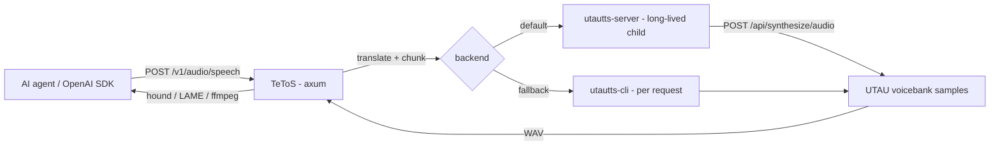

# TeToS — Teto as a Service

```
 ██████╗ ██████╗ ███████╗████████╗ ██████╗ ███████╗
 ██╔═══██╗██╔══██╗██╔════╝╚══██╔══╝██╔═══██╗██╔════╝
 ██║   ██║██║  ██║███████╗   ██║   ██║   ██║███████╗
 ██║   ██║██║  ██║╚════██║   ██║   ██║   ██║╚════██║
 ╚██████╔╝██████╔╝███████║   ██║   ╚██████╔╝███████║
  ╚═════╝ ╚═════╝ ╚══════╝   ╚═╝    ╚═════╝ ╚══════╝
```

**An OpenAI-compatible `/v1/audio/speech` endpoint that talks with UTAU voicebanks instead of a metered API.**

> The LLM does the thinking. Teto does the talking. Both are your problem now.

TeToS is a small Rust binary that:

1. spawns **one long-lived** [`UtauTTS`](https://github.com/yh2237/UtauTTS) server (CPU-only, no GPU, no neural voice cloning),
2. exposes `POST /v1/audio/speech`, `GET /v1/models` and `/health`,
3. translates OpenAI-shaped requests into UTAU synthesis calls,
4. returns mp3 / wav / pcm (and flac / opus / aac via `ffmpeg`).

Point any OpenAI client at it and your AI agent suddenly sounds like a concatenatively-synthesized diva. For **$0.00 per character**.

## Why

| | Hosted TTS | TeToS |
|---|---|---|
| Cost | pay per character | free |
| Hardware | somebody else's GPU | any CPU |
| Voice | "helpful assistant #4" | an anime icon with a haircut memory card |
| Licensing burden | vendor ToS | your voicebank's ToS |
| Meme potential | limited | **unbounded** |

We are not replacing your LLM. We are replacing the *bill* for its mouth.

## Architecture



There is **no fork of UtauTTS**. It is an external binary dependency, auto-detected on `PATH` or in `../UtauTTS`. Upstream stays free to change as fast as it likes.

## Quickstart

### 1. Get UtauTTS and a voicebank

Grab a [UtauTTS release](https://github.com/yh2237/UtauTTS/releases) for your OS (the release ZIPs include the compiled WORLD/OpenJTalk runtimes), or clone the repo next to this one:

```bash
git clone https://github.com/yh2237/UtauTTS.git ../UtauTTS
```

> If you **build UtauTTS from source**, also build `native/world-engine` and place
> `utautts-world-engine.so` in `../UtauTTS/runtime/` (or the matching `.dll`/`.dylib`).
> Otherwise synthesis fails with `WORLD engine was not found in runtime`. Release packages already include it.

Get the real diva with the bundled Playwright helper, or download manually from the [official archive](https://kasaneteto.jp/utau/):

```bash
npm i playwright
node scripts/fetch-teto.js          # saves TETO-tougou-110401.zip to ../UtauTTS/voice/
cd ../UtauTTS/voice && unzip TETO-tougou-110401.zip
```

Point TeToS at the extracted folder (each subdirectory containing `oto.ini` is detected automatically):

```bash
./target/release/teto-tss --voice-dir '../UtauTTS/voice/重音テト音声ライブラリー'
```

The `voice="teto"` alias resolves to Japanese-named banks automatically; root banks are preferred over subbanks.

> TeToS does **not** ship a voicebank. Check your voicebank's license before using it, especially commercially.

### 2. Build and run

```bash
cargo build --release
./target/release/teto-tss --doctor      # check dependencies
./target/release/teto-tss
```

If `utautts-server` is not on `PATH`, point to it explicitly:

```bash
./target/release/teto-tss \
  --utautts-server ../UtauTTS/utautts-server \
  --voice-dir ../UtauTTS/voice
```

You should see the banner, `UTAUTTS_READY=...`, and:

```
OpenAI-compatible endpoint ready at http://127.0.0.1:8000/v1/audio/speech
```

### 3. One-line migration

```python
from openai import OpenAI

client = OpenAI(
    api_key="anything-you-like",                  # we do not check it
    base_url="http://127.0.0.1:8000/v1",          # <- the entire migration
)

with client.audio.speech.with_streaming_response.create(
    model="teto",                                 # also accepts tts-1, gpt-4o-mini-tts
    voice="teto",                                 # or diva, queen, alloy...
    input="こんにちは。今日も現実をねじ曲げましょう。",
    response_format="mp3",
) as response:
    response.stream_to_file("teto.mp3")
```

Raw curl:

```bash
curl -sS http://127.0.0.1:8000/v1/audio/speech \
  -H 'Content-Type: application/json' \
  -d '{"model":"teto","voice":"teto","input":"Hello from the diva.","response_format":"wav"}' \
  -o hello.wav
```

## API

### `POST /v1/audio/speech`

Standard OpenAI fields:

| field | notes |
|---|---|
| `model` | accepted for compatibility; if it matches a UTAU prosody model id, that model is used |
| `input` | text to speak. Long text is auto-chunked at sentence boundaries (UTAU caps at 500 chars) |
| `voice` | voicebank id or alias (`teto`, `diva`, `queen`, …). String or `{"id":"..."}` |
| `response_format` | `mp3` (default), `wav`, `pcm`, `flac`, `opus`, `aac` |
| `speed` | `0.25`–`4.0`, mapped to UTAU mora/pause durations |
| `instructions` | accepted and politely ignored |
| `stream_format` | accepted; plain audio is returned |

Deep tuning via a namespaced `teto` object:

```json
{
  "model": "teto",
  "voice": "teto",
  "input": "私の声は無限に増殖する。",
  "response_format": "mp3",
  "speed": 1.1,
  "teto": {
    "language": "ja",
    "method": "waveform-synthesis",
    "model_id": "frame-intonation-tcn-v12",
    "intonation_strength": 5.0,
    "tone": "C4",
    "apply_pitch": true,
    "settings": { "timing_warp": false }
  }
}
```

Response headers include `X-TeToS-Voicebank`, `X-TeToS-Cost: $0.00`, and the upstream `X-UtauTTS-*` diagnostics.

### Other endpoints

- `GET /health` — status, voicebank count, uptime, emotional support
- `GET /v1/models` — voicebanks exposed as OpenAI "models" (plus familiar aliases so strict clients stop complaining)
- `GET /v1/voicebanks` — raw discovered catalog
- `GET /` — service info

## Configuration

Create `TeToS.toml` next to the binary (or pass `--config`):

```toml
[server]
host = "127.0.0.1"
port = 8000

[utautts]
# executable = "/path/to/utautts-server"
# cli_executable = "/path/to/utautts-cli"
# voice_dir = "/path/to/voicebanks"
# model_dir = ["/path/to/prosody/models"]
port = 0                  # 0 = pick a free loopback port for the child
extra_args = []           # escape hatch for new upstream flags
startup_timeout_secs = 90

[defaults]
voice = "teto"
language = "ja"
method = "waveform-synthesis"
response_format = "mp3"
intonation_strength = 4.0

[voices]
diva = "Kasane Teto"
queen = "Kasane Teto"
senpai = "Adachi Rei"
```

CLI flags and `TETOS_*` environment variables override the file. See `teto-tss --help`.

### Backends

- `--backend server` (default when a server binary is found): one child process, fast, HTTP API.
- `--backend cli`: one `utautts-cli` invocation per request. Slower, but depends on almost nothing upstream — useful when UtauTTS is in active development and its HTTP API shifts.
- `--backend auto`: prefer server, fall back to CLI.

## Staying update-proof with active upstream development

UtauTTS is under active development, so TeToS deliberately:

- never patches or vendors its source — only launches the published binary;
- auto-detects the executable in `PATH`, `../UtauTTS`, or via config;
- logs the reported upstream version instead of pinning or rejecting it;
- discovers voicebanks/models from `/api/voicebanks` and `/api/models`, with a directory scan fallback;
- parses only a lenient subset of upstream JSON and ignores unknown fields;
- passes unknown flags through via `[utautts].extra_args`;
- keeps the CLI backend as an escape hatch if the HTTP surface changes.

If an upstream release breaks something, the blast radius is `src/compat.rs` and `src/backend.rs`.

## Formats

| format | implementation | needs ffmpeg |
|---|---|---|
| `mp3` | pure-ish Rust via `mp3lame-encoder` (statically linked LAME) | no |
| `wav` | streamed from UtauTTS | no |
| `pcm` | 16-bit signed LE, header stripped | no |
| `flac`, `opus`, `aac` | piped through `ffmpeg` | **yes** |

Long inputs are synthesized chunk-by-chunk and re-joined into a single WAV before encoding.

## Legal / "no neural models were harmed"

- TeToS itself is MIT licensed.
- UtauTTS is MIT licensed; see its [`LICENSE`](https://github.com/yh2237/UtauTTS/blob/main/LICENSE).
- **Voicebanks have their own terms.** You supply the voicebank; you are responsible for following its license. This is especially important for commercial use. TeToS bundles none.
- There is no RVC, no voice conversion, no zero-shot cloning, and no training on voicebank samples. Just sample concatenation and frame selection, as UTAU intended.

## Troubleshooting

| symptom | fix |
|---|---|
| `No UtauTTS executable found` | install UtauTTS, set `PATH`, or pass `--utautts-server` |
| `No voicebanks found` | set `--voice-dir`; ensure sample folders contain `oto.ini` |
| `unknown voice '...'` | see `/v1/voicebanks` for exact ids, or add a `[voices]` alias |
| `response_format=opus needs ffmpeg` | install ffmpeg, or use `mp3`/`wav`/`pcm` |
| `WORLD engine was not found in runtime` | your UtauTTS source build lacks the compiled engine; use a release ZIP or build `native/world-engine` into `runtime/` |
| garbled Japanese audio | the voicebank may not support the requested phonemes; check its `oto.ini` and try another bank |
| upstream API changed | try `--backend cli`, then file an issue |

## Roadmap (aspirational, extremelyonsen)

- [ ] streaming response bodies so the diva speaks before the whole sentence is rendered
- [ ] `/v1/audio/speech` SSE mode
- [ ] voicebank hot-reload endpoint
- [ ] optional `RUST_LOG=tetos=debug` tracing of upstream diagnostics
- [ ] a small TUI so you can pet the voicebank
- [ ] absolutely none of the above involving an LLM for synthesis

Made with questionable judgement and an unreasonable amount of respect for a fictional android singer.
